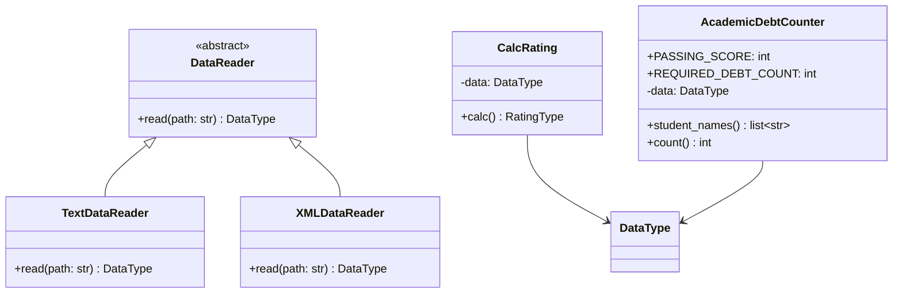

# Лабораторная работа № 1: Git и GitHub Actions


Проект выполнен по варианту 10. Он демонстрирует работу с Git, объектно-
ориентированное программирование, модульное тестирование и непрерывную
интеграцию с помощью GitHub Actions.

## Постановка задачи

Базовый проект должен прочитать оценки студентов и рассчитать средний рейтинг
каждого студента. Индивидуальная часть варианта 10 требует:

1. реализовать класс-наследник `DataReader` для чтения XML;
2. определить количество студентов, имеющих оценку ниже 61 ровно по двум
   предметам;
3. покрыть новые классы модульными тестами;
4. выполнить каждую часть в отдельной ветке и объединить её с `main`;
5. добавить лицензию, `.gitignore`, CI и UML-диаграмму.

## Описание решения

Все считыватели преобразуют входные данные к общему типу:

```python
dict[str, list[tuple[str, int]]]
```

`TextDataReader` обрабатывает базовый текстовый формат, а `XMLDataReader` —
XML варианта 10. `CalcRating` вычисляет средний балл. Класс
`AcademicDebtCounter` считает студентов, у которых ровно две оценки строго
меньше 61. Оценка 61 задолженностью не считается.

В XML используются корректные имена тегов, а ФИО и названия дисциплин
хранятся в атрибутах:

```xml
<students>
  <student name="Иванов Иван Иванович">
    <subject name="математика" score="60" />
  </student>
</students>
```

## Структура проекта

```text
PTLab1/
├── .github/workflows/python-ci.yml
├── data/
│   ├── data.txt
│   └── data.xml
├── docs/
│   ├── class-diagram.puml
│   └── theory.md
├── src/
│   ├── AcademicDebtCounter.py
│   ├── CalcRating.py
│   ├── DataReader.py
│   ├── TextDataReader.py
│   ├── Types.py
│   ├── XMLDataReader.py
│   └── main.py
├── test/
├── LICENSE
├── pyproject.toml
└── requirements.txt
```

## UML-диаграмма классов



Исходник диаграммы PlantUML также находится в `docs/class-diagram.puml`.

## Установка и запуск

Требуется Python 3.10 или новее.

```bash
python -m venv .venv
source .venv/bin/activate
python -m pip install -r requirements.txt
python -m src.main -p data/data.xml
```

В Windows активация окружения выполняется командой:

```powershell
.venv\Scripts\activate
```

Пример итоговой строки для демонстрационных данных:

```text
Students with debts in exactly two subjects: 1
```

## Проверка проекта

```bash
pycodestyle src test
python -m pytest
```

`pytest` автоматически измеряет покрытие ветвей кода и требует результат не
ниже 95%. Тесты проверяют штатное чтение TXT и XML, ошибочные входные данные,
граничное значение 61, средний рейтинг и интерфейс командной строки.

## Git и непрерывная интеграция

XML-считыватель разработан в ветке `feature/xml-reader`, а расчёт варианта —
в ветке `feature/debt-counter`. Обе ветки объединены с `main` отдельными merge-
коммитами.

Workflow `.github/workflows/python-ci.yml` запускается для push и pull request
в `main`. Он устанавливает Python 3.10, проверяет стиль `pycodestyle` и
запускает тесты `pytest`.

## Используемые технологии

- Python 3.10;
- стандартная библиотека `xml.etree.ElementTree`;
- pytest и pytest-cov;
- pycodestyle;
- Git и GitHub Actions;
- Mermaid и PlantUML для UML.

## Выводы

В работе создан проект с единым интерфейсом чтения нескольких форматов,
реализовано индивидуальное задание варианта 10 и написаны автоматические
тесты. Использование отдельных веток позволяет изолировать изменения, а
GitHub Actions автоматически проверяет стиль и корректность проекта после
обновления репозитория. Это снижает риск попадания ошибок в основную ветку и
демонстрирует практическое применение непрерывной интеграции.

Ответы на вопросы к защите приведены в `docs/theory.md`. Проект
распространяется по лицензии MIT.
